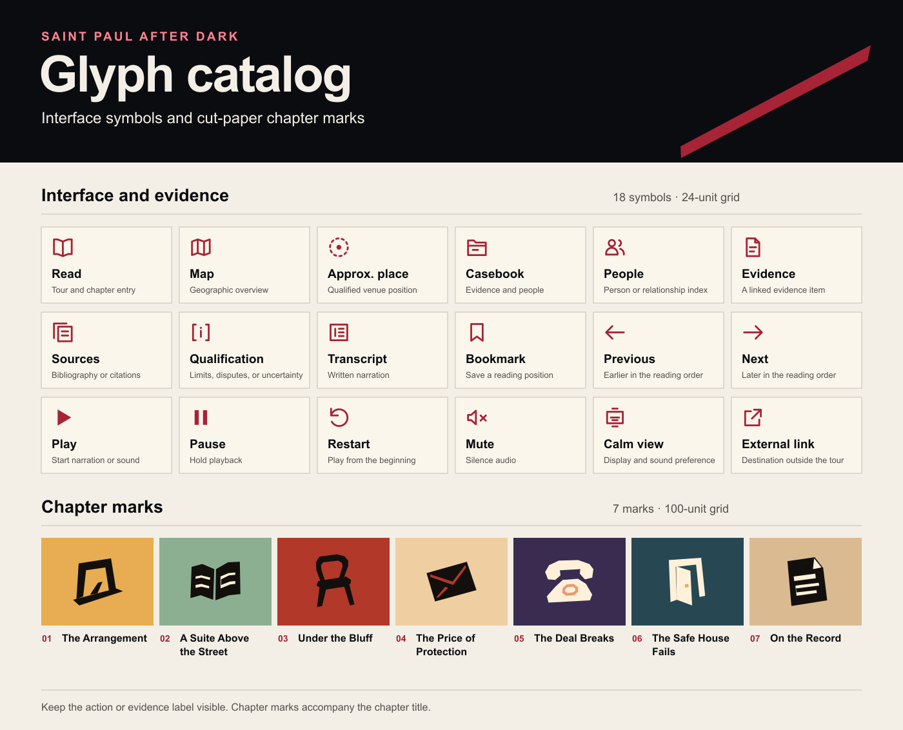

# Glyph and chapter mark guide



[Editable catalog SVG](assets/glyphs/glyph-catalog.svg) · [Combined SVG sprite](assets/glyphs/sprite.svg) · [Interface masters](assets/glyphs/interface/) · [Chapter masters](assets/glyphs/chapters/)

## Interface and evidence

Use the 24-unit family for navigation, actions and labels. The outline is 1.75 units with rounded joins and caps. Play and pause use filled silhouettes. Use a 24 px slot by default and 20 px for a compact, visibly labeled control. Keep interactive targets at least 44 × 44 CSS px and give the icon and label an 8 px gap. In print, start at 6 mm with a label and proof the smallest strokes at actual size.

Use ink `#171310` or oxblood `#B2382A` on paper `#FFF1D9`. Use paper or copper `#F58D72` on ink. Let icons inherit the label color in controls so hover, focus and forced-color states remain legible. Where a graphic carries information, use at least 3:1 contrast against the adjacent surface. Use at least 4.5:1 for ordinary text. Keep the action, status or qualification visible in words.

| Master | Suggested visible label | Use |
| --- | --- | --- |
| [Read](assets/glyphs/interface/read.svg) | Start the tour / Read chapter | Opens a reading entry point. |
| [Map](assets/glyphs/interface/map.svg) | Explore the map | Opens the geographic overview and venue directory. |
| [Approximate place](assets/glyphs/interface/place.svg) | Approximate venue position | Dashed outline and dot indicate qualified positions where the supporting source allows plotting. Keep the map’s number and legend when introducing the shape in a new layout. |
| [Casebook](assets/glyphs/interface/casebook.svg) | Open the casebook | Opens the collection of evidence and people. |
| [People](assets/glyphs/interface/people.svg) | People | Introduces a person or relationship index. Use names or roles when individual identity matters. |
| [Evidence](assets/glyphs/interface/record.svg) | View evidence | Links to an evidence entry. Use the evidence ID or title for a specific entry. |
| [Sources](assets/glyphs/interface/sources.svg) | See sources | Opens the bibliography or citation list. |
| [Qualification](assets/glyphs/interface/qualification.svg) | Limits of this account | Introduces the actual caveat, unresolved detail or competing account in words. |
| [Transcript](assets/glyphs/interface/transcript.svg) | Read the introduction transcript | Opens the written equivalent of the introduction narration. |
| [Bookmark](assets/glyphs/interface/bookmark.svg) | Save reading position | Indicates the local bookmark action. Use visible text for saved or failed states. |
| [Previous](assets/glyphs/interface/previous.svg) | Previous chapter | Moves earlier in the chapter sequence. |
| [Next](assets/glyphs/interface/next.svg) | Next chapter | Moves later in the chapter sequence. |
| [Play](assets/glyphs/interface/play.svg) | Play narration / Play scene sound | Starts the named audio channel. |
| [Pause](assets/glyphs/interface/pause.svg) | Pause narration | Pauses the named channel. |
| [Restart](assets/glyphs/interface/restart.svg) | Restart narration | Returns to the beginning of the named narration. |
| [Mute](assets/glyphs/interface/mute.svg) | Mute all | Toggles sound. Pair the icon with a visible label and a programmatic state. |
| [Calm view](assets/glyphs/interface/calm.svg) | Calm view | Toggles the simplified presentation preference. Keep the label visible and expose the active state. |
| [External link](assets/glyphs/interface/external.svg) | View the original source | Identifies an off-site destination. If a link opens a new window, say so in text. |

Approximate venue positions, unplaced stops, current condition and visitor access are separate facts. Use the tour’s map legend and directory wording for each. Reserve the place glyph for approximate plotted positions. Show unplaced stops with their own text in the directory.

## Chapter marks

The seven silhouettes retain the source geometry and title-frame colors of the existing cut-paper title sequence. Use them in chapter cards, editorial teasers, footers and print indexes alongside the corresponding chapter title. Start at 48 px or 12 mm, with at least one fifth of the displayed mark width as clear space around the artwork. Preserve the angular profiles and their negative space. The chapter number, title and mark should travel together whenever the sequence matters.

The SVG masters are transparent and contain the original foreground and detail fills. Place each on its listed frame color. Use the program's full name or identity mark for overall attribution. Reserve the chapter silhouettes for their chapters, including when a chapter illustration accompanies them.

| Chapter | Master | Frame | Foreground | Detail |
| --- | --- | --- | --- | --- |
| 1 · The Arrangement | [Threshold](assets/glyphs/chapters/threshold.svg) | `#E8AD52` | `#130F0C` | — |
| 2 · A Suite Above the Street | [Ledger](assets/glyphs/chapters/ledger.svg) | `#8CAF92` | `#130F0C` | `#FFF1D9` |
| 3 · Under the Bluff | [Chair](assets/glyphs/chapters/chair.svg) | `#B2382A` | `#130F0C` | — |
| 4 · The Price of Protection | [Letter](assets/glyphs/chapters/letter.svg) | `#EFCFA1` | `#130F0C` | `#B2382A` |
| 5 · The Deal Breaks | [Telephone](assets/glyphs/chapters/telephone.svg) | `#392C50` | `#FFF1D9` | `#EB9975` |
| 6 · The Safe House Fails | [Doorway](assets/glyphs/chapters/doorway.svg) | `#274852` | `#FFF1D9` | `#E6AA62` |
| 7 · On the Record | [Docket](assets/glyphs/chapters/docket.svg) | `#DABB91` | `#130F0C` | `#FFF1D9` |

If a chapter mark is itself part of the editorial explanation, describe it using the chapter’s symbol label in the stop catalog. For example, the empty chair in Under the Bluff can be described as “An empty cut-paper chair.” In a list where the adjacent title already carries the meaning, use an empty alt attribute for an image or hide the inline SVG from assistive technology.

## Implementation handoff

Use an individual SVG when placing art in a layout tool. For web integration, inline the sprite once with its definitions outside the accessibility tree, or serve it as a local same-origin asset. Reference `glyph-*` IDs for interface marks and `chapter-*` IDs for silhouettes. Chapter symbols inherit `color` for the base fill and accept `--chapter-detail` for the detail fill. Set both from the table when reproducing a title frame.

With a visible label, place `aria-hidden="true"` and `focusable="false"` on the SVG. The link or button remains the focus target. In a constrained icon-only control, place the accessible name on the button and retain a discoverable visible label or tooltip. Use a native button for actions, a native link for destinations and a visible focus ring for each. Put toggle state on the control with `aria-pressed` and leave its name stable.

```html
<a class="tour-link" href="/map/">
  <svg width="24" height="24" viewBox="0 0 24 24" aria-hidden="true" focusable="false">
    <use href="#glyph-map"></use>
  </svg>
  Explore the map
</a>
```

Use the app’s existing base-path helper for a live route. Keep the label readable at large text sizes and in forced colors. Treat the shapes as static in Calm view and reduced-motion settings.

For the tour, [GlyphSprite.astro](../src/components/GlyphSprite.astro) embeds the combined master in the page shell. [Glyph.astro](../src/components/Glyph.astro) provides the decorative icon in labeled controls and links. Use `<Glyph name="map"/>` within the existing link, alongside its text.

The chapter exports draw on [TitleSymbol.astro](../src/components/TitleSymbol.astro), [title-symbol.scss](../src/styles/title-symbol.scss), [title-sequence.scss](../src/styles/title-sequence.scss) and the [stop catalog](../src/data/stops.json). The [token file](../src/styles/tokens.css) supplies the shared palette and target-size baseline.
